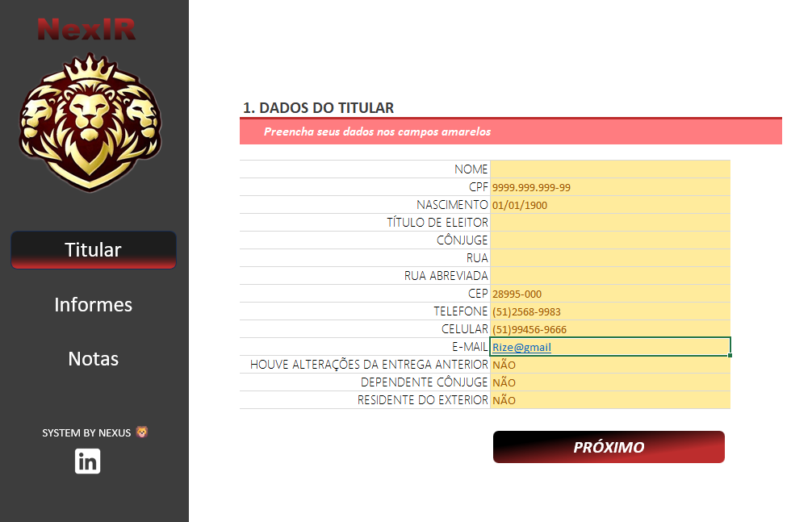
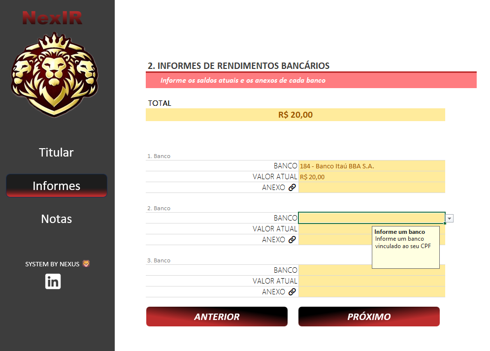

# 📊 Organizador Inteligente - Imposto de Renda (IRPF)

Projeto desenvolvido como parte do desafio prático da **DIO (Digital Innovation One)**. O objetivo é aplicar conceitos de engenharia de dados e usabilidade (UX) dentro do Microsoft Excel, criando uma ferramenta centralizada e à prova de erros para a organização prévia da declaração do Imposto de Renda.

> ⚠️ **Aviso Importante:** Este projeto é estritamente uma ferramenta de organização pessoal. Ele **não substitui** o programa oficial da Receita Federal (RFB), não calcula alíquotas fiscais finais e não garante conformidade tributária. Revise sempre seus dados antes de qualquer submissão oficial.

---

## 🎯 Objetivos da Solução

- Desenvolver uma interface clara e organizada para entrada de dados financeiros.
- Garantir a **Integridade dos Dados** através de listas suspensas (Data Validation) referenciadas em abas ocultas.
- Automatizar consolidações e cálculos de totalização, minimizando falhas humanas.
- Documentar e versionar o projeto utilizando boas práticas de desenvolvimento no GitHub.

## 🏗️ Arquitetura do Projeto (Estrutura de Abas)

O sistema foi modularizado separando as regras de negócio (Backend) da interface do usuário (Frontend).

| 🗂️ Aba | 🎯 Finalidade |
| :--- | :--- |
| **TITULAR** | Interface principal para informações cadastrais do titular e parâmetros base. |
| **INFORMES** | Módulo de registro de instituições financeiras e valores, com motor de totalização automática. |
| **NOTAS** | Log estruturado de lançamentos diários, segmentado por Data, Categoria e Valor. |
| **⚙️ Auxiliar** | Atua como o "Backend" do sistema. Armazena as listas matrizes utilizadas nas validações de dados para evitar inconsistências (Hardcoding). |

---

## 🚀 Como Utilizar (Setup)

1. Faça o download do arquivo `.xlsm` disponível nas *Releases* ou na raiz deste repositório.
2. Abra o arquivo no **Microsoft Excel** (versão Desktop recomendada).
3. **Aviso de Segurança:** Como o arquivo possui arquitetura de automação (VBA), o Excel exibirá uma tarja amarela. Clique em **"Habilitar Conteúdo"** (Habilitar Macros) para garantir que todas as validações de script funcionem corretamente.
4. Preencha sequencialmente os dados partindo da aba `TITULAR`, movendo-se para `INFORMES` e, por fim, registrando as movimentações na aba `NOTAS`.

---

## 🔒 Boas Práticas e Segurança de Dados

- **Privacidade Zero-Trust:** Nunca comite (faça upload) no GitHub versões desta planilha contendo seu CPF, RG, endereços reais ou chaves PIX.
- **Ambiente de Testes:** Para demonstrações de portfólio (como as imagens abaixo), utilize exclusivamente **dados fictícios** (Mock data).
- Faça backups regulares (versionamento local) antes de alterar a estrutura de abas, para não quebrar referências do VBA ou das fórmulas estruturadas.

---

## 📸 Interface e Navegação

*(Insira as capturas de tela do projeto em Dark Mode ou padrão nas pastas correspondentes)*

### Dashboard - Aba Titular

### Motor de Consolidação - Aba Informes

### Lançamentos Estruturados - Aba Notas

---

## 🛠️ Tecnologias e Recursos Empregados

- **Microsoft Excel:** Fórmulas dinâmicas, Formatação Condicional e Validação de Dados Avançada (Data Validation).
- **VBA (Visual Basic for Applications):** Suporte a automações de transição de tela e higienização de dados no arquivo `.xlsm`.
- **Git / GitHub:** Versionamento de código e hospedagem.
- **Markdown:** Documentação técnica estruturada.

---

## 👨‍💻 Autor

**Anthony / Fundador | Rize Nexus / Landing Pages / Apps / Automation Specialist**
